<!-- CUSTOM ANIMATED HERO -->

  

  

  
  
  
  

 

  <samp>ENGINEERING WITH INTENT · RESEARCH WITH CURIOSITY</samp>

---

## ✦ The person behind the code

I'm **Fahim**, a Software Engineering undergraduate at **Chengdu Neusoft University, China**.

I build across **Android, backend systems, and AI-powered web applications**, while exploring how intelligent systems can become more useful without compromising personal privacy.

My research interests center on **on-device language models, privacy-preserving personalization, computer vision, and applied machine learning**.

<table>
<tr>
<td width="50%" valign="top">

### 🎓 Academic foundation

**B.S. Software Engineering**  
Chengdu Neusoft University  
2024–2028 · Expected graduation

</td>
<td width="50%" valign="top">

### 🔭 Current interests

Privacy-preserving AI  
On-device LLMs & contextual intelligence  
Mobile learning & collaboration  
Practical, human-centered software

</td>
</tr>
</table>

 

## ✦ Where curiosity becomes research

<table>
<tr>
<td>

### Intelligence that stays closer to you.

**PersonaMQA — Context-Aware Persona Inference Engine for Privacy-Preserving Cross-Platform Mobile Messaging Automation**

A privacy-first research framework exploring personalized mobile messaging automation while keeping raw chat content local to the device.

🔹 **On-device inference** with Qwen 2.5-7B and Phi-3 Mini explored in the research  
🔹 **Entropy-weighted persona extraction** for contextual personalization  
🔹 **Sentiment and urgency signals** to inform response generation  
🔹 **Relationship-aware responses** grounded in messaging context

**Status:** TechRxiv preprint

</td>
</tr>
</table>

 

## ✦ Selected things I've built

<table>
<tr>
<td width="50%" valign="top">

### 💡 TubeLight
**A personal multimodal AI workspace**

Multi-model chat, document-grounded answers, and private content storage in one workspace.

- PDF, Markdown & text document RAG
- Embeddings and vector retrieval
- Per-user storage with row-level security
- Authentication and AI gateway integration

**Built with**  
`React` `TypeScript` `Tailwind CSS`  
`InsForge` `PostgreSQL`

<a href="https://github.com/fahimimtiaz12/TubeLight">Explore the repository ↗</a>

</td>
<td width="50%" valign="top">

### 🎓 CNU CampusMate
**Campus life, connected**

A WeChat Mini Program bringing university information and student services together.

- 22 registered application pages
- Student, teacher & administrator workflows
- Schedules, results, bookings & navigation
- Help Center and Lost & Found

**Built with**  
`JavaScript` `WXML` `WXSS`  
`Supabase` `PostgreSQL` `Amap`

</td>
</tr>
<tr>
<td width="50%" valign="top">

### ⏱️ PacePal
**Study with focus. Learn together.**

An Android productivity application combining personal planning and collaborative study.

- Homework planning and Pomodoro sessions
- Progress charts, streaks, XP & badges
- Study groups, shared notes & real-time chat
- Group meetings and PDF certificates

**Built with**  
`Kotlin` `Jetpack Compose` `Room`  
`Firebase` `Vercel` `JaaS`

</td>
<td width="50%" valign="top">

### 🧩 DevPlay
**From learning Java to writing it**

A guided Android learning experience built around practice and meaningful feedback.

- Lessons, videos & coding challenges
- Editor/compiler interface and output checks
- AI-assisted tutoring and debugging
- Quizzes, progress & content administration

**Built with**  
`Java` `Android`  
`Firebase` `Cloud Firestore`

</td>
</tr>
</table>

<b>＋ Behind the projects: experiments & future directions</b>

 

**Applied machine learning**

Ongoing work on imbalanced tabular classification using LightGBM and CatBoost, with prior XGBoost experiments. Areas of focus include cross-validation, missing-value handling, ratio features, target-encoding experiments, and blended predictions.

**PacePal 2.0 — planned enhancements**

AI homework assistance, document summaries, quiz generation, smart planning, and expanded group-study support.

**Additional work**

Android Music Player and the Central Advert Agency Website, alongside portfolio-listed concepts for billing, student management, library management, and task/habit tracking.

 

## ✦ Tools behind the ideas

  <samp>LANGUAGES</samp>

  

  <samp>WEB & BACKEND</samp>

  

  <samp>DATA, CLOUD & DEVELOPMENT</samp>

  

 

| Engineering focus | Technologies & concepts |
| :--- | :--- |
| 🧠 **AI & research** | LLMs · RAG · prompt engineering · computer vision · YOLOv8 · edge AI |
| 📊 **Machine learning** | LightGBM · CatBoost · feature engineering · model evaluation |
| ⚙️ **Backend** | Spring Boot · Spring Security · REST APIs · authentication & authorization |
| 📱 **Android** | Compose · Material 3 · Room · WorkManager · OkHttp |
| ☁️ **Connected applications** | Firebase · FCM · Supabase · serverless APIs · JWT integration |
| 🧱 **Foundations** | OOP · algorithms · data structures · design patterns · technical writing |

 

## ✦ Beyond the screen

> Learning becomes more meaningful when you help someone else move forward.

- **Scrimbambassador** — Scrimba
- **Campus Ambassador, Season 2** — ICT Olympiad Bangladesh
- Former **teacher / learner mentor** — Code With Redoy
- **Cadet Lance Corporal** — BNCC Air Wing
- Former **student volunteer** — Blood Bank at BAF Shaheen College
- **GCI World 2026 participant** — data science learning activities

<b>🎖️ View all 29 certificates, credentials & recognitions</b>

 

The list below follows the certificate and recognition register in my CV. Credential IDs and verification notes are reproduced as recorded; I have not invented verification URLs where the source does not provide one.

####  IBM SkillsBuild · 2

- **Make Agentic AI Work for You** — Credly reference: `Qq4pAG90`
- **Web Development Fundamentals** — Credly badge ID: `90793177-7989-40be-ab13-16ee10d28a27`

####  The Open University / OpenLearn · 4

- **An introduction to computers and computer systems** — Course page
- **An introduction to artificial intelligence** — Course page
- **Systems thinking and practice**
- **Introducing computing and IT**

####  Code with Mosh · 4

- **Complete SQL Mastery** — `cert_zh3z6hkm`
- **Ultimate Java Part 3: Advanced Topics** — `cert_gjk5jp4d`
- **Ultimate Java Part 2: Object-oriented Programming** — `cert_fj9l00sp*`
- **Ultimate Java Part 1: Fundamentals** — `cert_p3sxb2c2`

####  Wadhwani Foundation · 9

- **Problem Solving & Innovation** — `6abb52c1b14b60e6f0ff4d46`
- **Professionalism** — `6abb50c6fa09ff77a7eee9ac`
- **Impactful Writing Skills** — `6ab9fe92fa09ff77a7ec0718`
- **Customer Centricity** — `6ab9eae7739c0c43a7b3024d`
- **Work Productivity Tools (US English)** — `6ab9e97728d7cd24ec723f9d`
- **Interpersonal Skills** — `6ab9e69db14b60e6f0fc02ca`
- **Online Communication & Data Security** — `6ab9df6d53737975de3cb6f5`
- **Effective Speaking and Listening Skills (US English)** — `6ab9df5bfa09ff77a7eb82e4`
- **21st Century Employability Skilling Program – Advanced at the Basic Level** — `65a165418c30de8667c3e236`

####  Elsevier Research Academy / Information Sciences · 3

- **Going through peer review** — Certificate copy referenced in the CV (Dropbox)
- **Certified Peer Reviewer Course** — Certificate copy referenced in the CV (Dropbox)
- **Reviewer Recognition — Information Sciences** — Certificate copy referenced in the CV (Dropbox)

####  ICT Olympiad Bangladesh · 1

- **Campus Ambassador — Season 2** — Certificate number: `2026305872`

####  Amar iSchool · 1

- **Research Paper Writing Course** — `AiS2138`

####  Educative · 1

- **Mastering OpenAI Codex for Agentic Coding** — `ENW21VKS97`

####  DataCamp · 2

- **Python Data Associate** — `PDA0019646631858`
- **AI Engineer for Developers Associate** — `AIEDA0014456713569`

####  NonprofitReady · 1

- **Fundraising Essentials Certificate Program**

####  Cisco · 1

- **English for IT 1** — Credly badge (ID not listed in the CV)

 

## ✦ Small commits. A longer journey.

  <picture>
    <source media="(prefers-color-scheme: dark)" srcset="https://raw.githubusercontent.com/fahimimtiaz12/fahimimtiaz12/output/github-snake-dark.svg?v=20261116-pink" />
    <source media="(prefers-color-scheme: light)" srcset="https://raw.githubusercontent.com/fahimimtiaz12/fahimimtiaz12/output/github-snake.svg?v=20261116-indigo" />
    
  </picture>

 

---

## ✦ Find me around the web

  <samp>SOFTWARE · APPLIED AI · RESEARCH · OPEN SOURCE</samp>

<strong>Professional & research profiles</strong>

  
  
  
  
  

  
  
  

<strong>Social profiles</strong>

  
  
  

  

<strong>Direct contact</strong>

  
  

  Scrimba profile name is listed in my CV; a direct profile URL was not included in the source materials.

  

